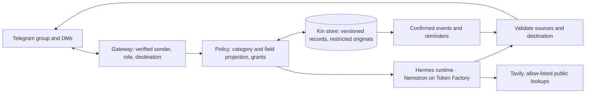

# Kin

**The family member who remembers everything — and tells no one who shouldn't know.**

Kin is a private, always-on care coordinator for families looking after an ageing parent. It lives in the family's Telegram group and in each member's DM. The primary caregiver photographs a discharge letter in DM; Kin drafts the records with source excerpts, the caregiver confirms, and the schedule goes live: reminders to the helper's phone, a confirmed summary to the group in English and Mandarin. Months later, when a brother overseas asks "what did Dr Tan change last time?", Kin answers from permitted records with the source excerpt. A question about the insurance claim gets a neutral group reply and a private request to the caregiver: share it, once, or not.

Records live on self-hosted storage; Telegram carries messages; approved context goes to **NVIDIA Nemotron on Nebius Token Factory** for inference. Each person sees only what their role allows, enforced before retrieval and before delivery — not by prompt.

Built for the [Nebius x NVIDIA Global AI Hackathon](https://nebiusglobalaihackathon.devpost.com/), Personal AI track. Singapore locale; the locale is a swappable pack.

## Status

Configuration, policy loading and setup checks exist; `kin serve`, memory, intake and reminders are not implemented. Nano Omni is dedicated-only on Token Factory, so photo extraction uses a public vision model chosen at D0 (`make models`). See [ROADMAP.md](ROADMAP.md).

## Why

- 63 million US caregivers (1 in 4 adults), up ~50% since 2015; 55% perform medical/nursing tasks, 22% trained; 1 in 3 finds coordination hard (AARP/NAC 2025).
- Singapore is super-aged in 2026 (1 in 5 aged 65+); family eldercare hours projected to rise from 29 to 41 per week; 55% of working caregivers left work for a parent's doctor visit in the past six months.
- Coordination happens in a group chat and a shoebox of paper; existing apps are cloud SaaS or human services. Kin combines chat-native intake, source-grounded memory, confirmed scheduling, a reusable skill and audited per-person sharing.

Details: [docs/01-problem.md](docs/01-problem.md).

## Minimum product

| Flow | Behaviour |
|---|---|
| Private intake | Admin sends a photo in DM → draft records with source excerpts → Admin confirms → schedule active |
| Reminder | Confirmed time and assignee; delivered to the carer's DM; supersession cancels future reminders |
| Group summary | Admin-confirmed summary only, English and Mandarin |
| Recall | Answer from the asker's permitted records with an approved source excerpt |
| Sharing | Finance/legal questions → neutral group reply → Admin DM: Yes / No / Just this once → private answer; audited |
| Reusable skill | One scheduled skill ("every Monday remind Siti to refill the pill organiser") that survives restart |
| Public lookup | Tavily on the locale allow-list; no family data in queries |

Optional: audio debrief, teach-by-chat skills, weekly digest, viewer expiry, full 20-document fixture, OpenShell isolation, data-map page. Product: [docs/02-product.md](docs/02-product.md). Boundaries: [docs/03-privacy-boundaries.md](docs/03-privacy-boundaries.md).

## How it works



- **Hermes Agent** (MIT): runtime, Telegram gateway, scheduled skills. Its native memory, session search and file/terminal tools are disabled over family data; Kin owns memory and policy.
- **Nebius Token Factory**: Nemotron Nano/Lightning for classification, Super for grounded answers; a public vision model for photo extraction (Nano Omni is dedicated-only).
- **Tavily**: public lookups filtered to the locale allow-list.
- **OpenShell/NemoClaw**: optional process and network isolation; it does not implement family roles.

Architecture: [docs/05-architecture.md](docs/05-architecture.md).

## Safety

Kin organises confirmed records and reminders. It never diagnoses, doses, triages or infers drug interactions; discrepancies between documents are shown for confirmation. Every personal answer carries its permitted source. All demo data is synthetic. [docs/04-safety.md](docs/04-safety.md).

## Quick start

Requires [uv](https://docs.astral.sh/uv/) and Docker with Compose v2.

```bash
make setup             # deps; .env from example; data/ and hermes/home/
$EDITOR .env           # keys, verified Telegram IDs, model IDs (KIN_MODEL_VISION from `make models`)
make policy            # validate the matrix shape (runtime enforcement is D2)
make lint && make test
make models            # Nemotron and image-capable models visible to the key
make check             # live probes: models, one image call, Telegram getMe, Tavily
make up                # kin self-check + Hermes gateway (first start installs Hermes into ./hermes/home)
```

`hermes/config.yaml` seeds the gateway (Nebius provider; Kin MCP server disabled until D2). Setup gates: [KICKOFF.md](KICKOFF.md).

## How we use Nebius and NVIDIA

_Filled from real runs at D5: model IDs, image/text usage, latency, estimated cost, what leaves the host, deployed isolation._

## Layout

```
README.md · AGENTS.md · KICKOFF.md · ROADMAP.md · LICENSE (Apache-2.0)
pyproject.toml · uv.lock · .python-version · .env.example · Makefile · Dockerfile · docker-compose.yml
kin/               # config, policy, cli, setup_check; serve/intake/retrieve per ROADMAP
config/policy.yaml · locale/sg/ · hermes/ (config template; home/ is the runtime volume) · docker/hermes/
data/ (volume) · tests/ · docs/ · .github/workflows/ci.yml
```

## Docs

| Doc | Content |
|---|---|
| [AGENTS.md](AGENTS.md) | Instructions for coding agents |
| [KICKOFF.md](KICKOFF.md) | One-time setup; **YOU** items need the human |
| [ROADMAP.md](ROADMAP.md) | Sequential deliverables and gates |
| [00-hackathon.md](docs/00-hackathon.md) | Requirements, judging, prizes, platform facts |
| [01-problem.md](docs/01-problem.md) | Problem, evidence, landscape ([sources](docs/sources.md)) |
| [02-product.md](docs/02-product.md) | Roles, minimum flows, chat conventions |
| [03-privacy-boundaries.md](docs/03-privacy-boundaries.md) | Minimum boundary, matrix, hardening, tests |
| [04-safety.md](docs/04-safety.md) | Organise-not-advise, confirmation, consent, data flow |
| [05-architecture.md](docs/05-architecture.md) | Components, models, data, flows, Hermes hardening |
| [06-synthetic-data.md](docs/06-synthetic-data.md) | Demo family, fixture, generation |
| [07-demo-plan.md](docs/07-demo-plan.md) | Video script, judge access |
| [08-submission-checklist.md](docs/08-submission-checklist.md) | Devpost checklist |

## License

Apache-2.0.
