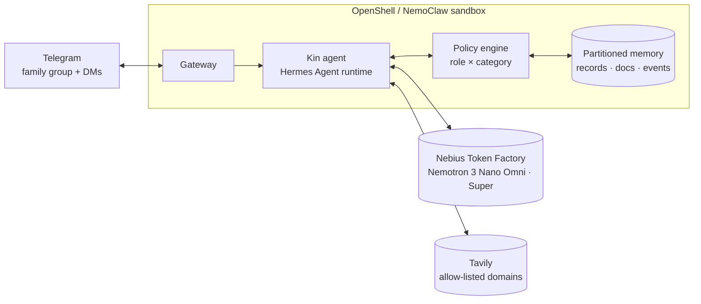

# Kin

**The family member who remembers everything — and tells no one who shouldn't know.**

Kin is a private, always-on care coordinator for families looking after an ageing parent. It joins the family's Telegram group as a member. Photograph the discharge letter and the pill boxes: Kin builds the medication schedule, sets reminders on the helper's phone, flags the one question worth asking the pharmacist, and posts a plain-language summary to the group — in English, and in Mandarin for the aunt who prefers it. Months later, when a brother overseas asks "what did Dr Tan change last time?", Kin answers with the exact change and the photo it came from. Ask about the insurance claim in the group and Kin replies privately to the primary caregiver: that's family-admin information, shall I share it?

Kin runs in a sandbox the family controls, with open NVIDIA Nemotron models served through Nebius. Each person sees only what their role allows, enforced where data is retrieved — not by prompt.

Built for the [Nebius x NVIDIA Global AI Hackathon](https://nebiusglobalaihackathon.devpost.com/), Personal AI track. Singapore locale; the locale is a swappable pack.

## Why

- 63 million US caregivers (1 in 4 adults), up ~50% since 2015; 55% perform medical/nursing tasks, 22% trained; 1 in 3 finds coordination hard (AARP/NAC 2025).
- Singapore is a super-aged society in 2026 (1 in 5 aged 65+); family eldercare hours projected to rise from 29 to 41 per week; 55% of working caregivers left work for a parent's doctor visit in the past six months.
- Coordination happens in a group chat and a shoebox of paper.
- Funded players (Hera, Cariloop, Wellthy, Caring Village) are human services or cloud apps. None is a private, self-hosted, memory-first agent in the family's existing chat.

Details: [docs/01-problem.md](docs/01-problem.md).

## What it does

| Flow | In chat |
|---|---|
| Intake | Photo of a letter, label, slip or report → structured record with source, filed, scheduled, summarised |
| Schedule & reminders | Medication times, refills, appointments; reminder to the responsible person |
| Ask | "What did the cardiologist change in March?" → answer + source photo |
| Boundaries | Role-based views; sensitive answers to DM; share-request flow; `/who-saw` audit |
| Appointment prep & debrief | Question list before; with consent, recorded consult → summary, records, action items after |
| Weekly digest | Role-appropriate summary per member, in their language |
| Skills | "Every Monday remind Siti to refill the pill organiser and send a photo" — taught once |
| Local lookups | Scheme rules, clinic hours from allow-listed domains; no family data in queries |

Product: [docs/02-product.md](docs/02-product.md). Boundaries: [docs/03-privacy-boundaries.md](docs/03-privacy-boundaries.md).

## How it works



- **Hermes Agent** (MIT): always-on runtime, persistent memory, skills, Telegram gateway.
- **OpenShell / NemoClaw**: sandbox, credential proxying, network allow-list.
- **Nemotron 3 Nano Omni** reads photos, documents and audio; **Nemotron 3 Super** reasons and drafts; served via Nebius Token Factory (dedicated Nebius endpoint supported).
- **Tavily**: public information from an allow-list.

Architecture: [docs/05-architecture.md](docs/05-architecture.md).

## Safety

Kin organises; it does not diagnose or dose. Every statement about the care recipient carries its source. Consent is required before any recording. [docs/04-safety.md](docs/04-safety.md).

## Demo

All demo data is synthetic: fictional family, fictional institutions, generated documents. [docs/06-synthetic-data.md](docs/06-synthetic-data.md) · [docs/07-demo-plan.md](docs/07-demo-plan.md).

## Quick start

Requires [uv](https://docs.astral.sh/uv/) (Python 3.12 is fetched automatically) and Docker with Compose v2 for the runtime.

```bash
make setup             # .venv + dependencies; creates data/, hermes/home/; copies .env.example → .env
$EDITOR .env           # NEBIUS_API_KEY, TAVILY_API_KEY, TELEGRAM_BOT_TOKEN, KIN_ADMIN_TELEGRAM_ID, TELEGRAM_* allow-lists
make check             # keys · policy/locale · models · one Omni vision call · Telegram getMe · Tavily
make policy            # print and validate the role × category matrix
make up                # kin service + Hermes gateway (first start installs Hermes into ./hermes/home)
make logs
```

`hermes/config.yaml` is the template seeded into the Hermes home on first start; it sets the Nebius Token Factory provider and registers Kin's MCP server (disabled until `kin serve` exists, ROADMAP D3). `make hermes-shell` opens a shell with `hermes` on the PATH for `hermes doctor`, `hermes model`, `hermes gateway setup`.

Layout:

```
kin/
  README.md · AGENTS.md · KICKOFF.md · ROADMAP.md · LICENSE (Apache-2.0)
  pyproject.toml · uv.lock · .python-version · .env.example
  Makefile · Dockerfile · docker-compose.yml
  kin/               # package: config, policy, cli, setup_check; intake/retrieve/serve land per ROADMAP
  config/policy.yaml # default role × category matrix
  locale/sg/         # Singapore locale pack (languages, lookup allow-list, terms, document types)
  hermes/            # config.yaml template; home/ is the gateway's persistent volume (git-ignored)
  docker/hermes/     # Hermes container (installs on first start, runs `hermes gateway run`)
  data/              # family data volume (git-ignored)
  tests/ · docs/ · .github/workflows/ci.yml
```

## How we use Nebius and NVIDIA

_Required by the hackathon. To be filled with model IDs, endpoint type, tokens per intake, where Token Factory accelerated the workflow, how OpenShell/NemoClaw is used._

## Docs

| Doc | Content |
|---|---|
| [AGENTS.md](AGENTS.md) | Instructions for coding agents: reading order, conventions, constraints, guardrails |
| [KICKOFF.md](KICKOFF.md) | One-time setup; items needing the human are marked |
| [ROADMAP.md](ROADMAP.md) | Sequential deliverables and order of work |
| [00-hackathon.md](docs/00-hackathon.md) | Hackathon requirements, judging criteria, dates, platform facts |
| [01-problem.md](docs/01-problem.md) | Problem, evidence, users, landscape ([sources](docs/sources.md)) |
| [02-product.md](docs/02-product.md) | Scope, roles, categories, flows, chat conventions |
| [03-privacy-boundaries.md](docs/03-privacy-boundaries.md) | Boundary model, policy matrix, enforcement, audit |
| [04-safety.md](docs/04-safety.md) | Organiser-not-adviser rules, grounding, consent, data protection |
| [05-architecture.md](docs/05-architecture.md) | Components, data model, flows, models, integrations |
| [06-synthetic-data.md](docs/06-synthetic-data.md) | Demo family, timeline, document set, generation |
| [07-demo-plan.md](docs/07-demo-plan.md) | Video script, judge access |
| [08-submission-checklist.md](docs/08-submission-checklist.md) | Devpost requirements, feedback template |

## License

Apache-2.0.
