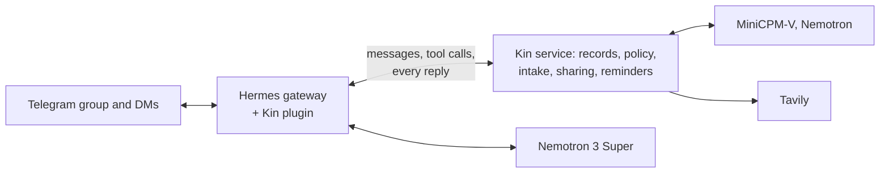

# Kin

**The family member who remembers everything, and tells no one who shouldn't know.**

Kin is a care coordinator for families looking after an ageing parent. It lives in the family's Telegram group and in each member's private chat, keeps the family's care documents, and shows each person only what their role allows. That boundary is enforced in code: before the model sees anything, and again before every reply is sent.

Built for the [Nebius x NVIDIA Global AI Hackathon](https://nebiusglobalaihackathon.devpost.com/) (Personal AI track) with NVIDIA Nemotron and MiniCPM-V on Nebius Token Factory. Singapore locale. All data is synthetic.

## What it does

- **Reads paper.** The family admin photographs a discharge summary in a private chat. Kin drafts the records, asks about anything doubtful (an unknown medicine name, a time two documents disagree on) and files nothing until she confirms.
- **Keeps everyone in step.** Confirmed medicines become reminders for the helper; the admin approves one group update, posted in English and Mandarin.
- **Answers by role.** Asked about the June clinic review, the admin gets the clinical notes and her brother only the medicine change, each with the quoted source.
- **Shares on request.** A question about money gets a neutral reply in the group and a private request to the admin: share, share once, or not. `/who_saw` reports every disclosure.
- **Runs a weekly skill** ("every Monday, remind Siti to refill the pill organiser and tell Mei Ling when done") that survives restarts.
- **Looks up public schemes** with Tavily, sending only the scheme's name, and never decides eligibility.

Why: one in four US adults is a family caregiver, and one in three of them finds coordinating care hard. Singapore becomes super-aged in 2026 ([evidence](docs/01-problem.md)).

## Try it (judges)

The bot and the group invite link are in the Devpost testing instructions. Your one Telegram account plays the whole made-up family: Ah Ma (78) is home from hospital, her daughter Mei Ling keeps the records, her son Wei Jie lives overseas and Siti is the live-in helper. Messages for someone you aren't playing arrive labelled ("For Mei Ling (Admin):"). Each tester gets a fresh family.

| # | Where | Send | Expect |
|---|---|---|---|
| 1 | Bot DM | `/demo admin` | You are Mei Ling, who sees everything |
| 2 | Bot DM | `/demo photos`, then send both pages back together | A draft of the discharge summary (about 10 s a page). Answer any question, then tap **Confirm** |
| 3 | Bot DM | **Post to group** | The group gets the update in English and Mandarin; Siti's new schedule arrives, labelled for her |
| 4 | Bot DM | `What happened at Ah Ma's June review with Dr Tan?` | Blood pressure 152/88, kidney tests, a review in 4 months, Losartan started |
| 5 | Bot DM | `/demo family`, then the same question | Only the Losartan plan: the clinical notes stay with Mei Ling |
| 6 | Group | `Kin, has the insurance claim gone through?` | The group sees "I've asked Mei Ling to share that." Tap **Just this once** in your DM: Wei Jie gets the insurer's words, not the amount |
| 7 | Bot DM | `/demo admin`, then `/who_saw` → Insurance letter | Who was shown what, and when |

More to try:
- `/demo monday` sends Siti's 08:00 reminders and the weekly skill.
- `Kin, is Ah Ma eligible for the Home Caregiving Grant?` in the group.
- As Wei Jie, `Please send me the discharge letter.` (originals never leave Kin).
- `/demo reset` starts over.

Reminders follow `/demo monday` rather than the clock. If someone else is mid-tour, Kin says so; the demo frees up after 10 quiet minutes.

## How it works



- **Hermes Agent** is the runtime and the only Telegram poller. A small Kin plugin attaches the verified sender and chat to every call (Hermes gives MCP tools no caller identity). It sends photos, commands and button taps to Kin before any model runs, and passes every reply through Kin's check. Hermes' own memory, skills, cron and host tools are off.
- **The policy is data:** a role × category matrix with field limits (`config/policy.yaml`) and the roster (`config/members.yaml`). Retrieval applies it before the model sees anything. The reply check withholds any answer that contains something the chat may not see.

More: [architecture](docs/05-architecture.md), [privacy boundaries](docs/03-privacy-boundaries.md).

## How we use Nebius and NVIDIA

Every model call goes to Nebius Token Factory; there is no other inference provider.

| Model | Used for |
|---|---|
| Nemotron 3 Super (`nvidia/nemotron-3-super-120b-a12b`) | Every conversation turn: choosing Kin's tools and writing grounded answers; the Mandarin group post |
| MiniCPM-V 4.5 (`openbmb/MiniCPM-V-4_5`) | Reading photos. Nemotron Nano Omni is dedicated-only on Token Factory, so this public vision model stands in |

Measured with real calls at list prices (`make measure`, 19 Oct 2026):
- Reading a photographed page takes 5–6 s and about USD 0.0013.
- An answer costs about USD 0.002, because it takes two Super calls.
- Live Telegram turns took 5.1 s (median).
- A family asking ten questions a day and sending two documents a week would spend under USD 1 a month.

Thinking mode is off for Kin's calls: with it on, both models spent their budget reasoning and returned truncated output.

**What leaves the host:** Telegram carries messages and photos. Token Factory receives what the person may see in that chat, plus photos sent for intake. Tavily receives only a listed scheme's name. Records, originals and the audit log stay in SQLite on the host.

**Deployment:** one Docker Compose project, no published ports, capped resources. OpenShell/NemoClaw isn't deployed.

## Safety and limits

- **Organises, never advises:** Kin never diagnoses, doses or infers drug interactions. Conflicting documents go to the admin, nothing is scheduled until she confirms, and every personal answer names its source ([safety](docs/04-safety.md)).
- **Limits:**
  - one family per deployment, and the demo serves one tester at a time
  - no audio: there is no public audio model on Token Factory
  - the reply check catches verbatim leaks; a paraphrase of something seen earlier in a session relies on the model's instructions, so a role change starts a fresh session

## Status

- **Built:** private photo intake with confirmation, reminders, the bilingual group post, role-scoped answers, sharing with an audit trail, the weekly skill, the public lookup and the self-service judge demo.
- **Not built:** audio, visit debriefs, teaching new skills by chat, weekly digests, OpenShell isolation, `/export`.
- **Validated:** live in Telegram, with two accounts and from a clean judge account (18–29 Oct 2026). 88 automated tests run in CI.

## Run it yourself

You need [uv](https://docs.astral.sh/uv/), Docker with Compose v2, a Telegram bot, and Nebius and Tavily API keys.

1. Create the bot with @BotFather and turn **Group Privacy** off. Add the bot to the family group, and have each member open a private chat with it and send `/start` (bots can't start chats).
2. Run `make setup`, then fill in `.env`:
   - the keys
   - the group's chat ID
   - members' numeric Telegram IDs (message @userinfobot)
   - a long random `KIN_API_TOKEN`
3. Run:

```bash
make lint && make test
make check        # live probes: models, one image call, Telegram, Tavily
make up           # kin + Hermes gateway; the first start installs Hermes into ./hermes/home
make seed         # load the synthetic Week 0 family
```

- **Judge demo:** set `KIN_DEMO=true` and `TELEGRAM_ALLOW_ALL_USERS=true`, then run `make up && make demo-reset`. Reset it daily with cron, giving the full path to `uv`: `0 15 * * * cd /path/to/kin && make demo-reset UV=/path/to/uv >> data/demo-reset.log 2>&1`.
- **After editing `hermes/config.yaml` or `hermes/SOUL.md`:** run `make hermes-config`.
- **Re-rendering the fixture documents:** run `make setup-data`. It needs `libpango-1.0-0 libpangoft2-1.0-0 libharfbuzz-subset0`.
- **Everything else:** `make help` lists every command.

## Docs

| Doc | What's in it |
|---|---|
| [01 · Problem](docs/01-problem.md) | The problem, the evidence, the alternatives |
| [02 · Product](docs/02-product.md) | Roles, flows, chat conventions |
| [03 · Privacy boundaries](docs/03-privacy-boundaries.md) | Who sees what, and how it's enforced |
| [04 · Safety](docs/04-safety.md) | What Kin will and won't do |
| [05 · Architecture](docs/05-architecture.md) | Components, the Hermes plugin, flows, deployment, code map |
| [06 · Synthetic data](docs/06-synthetic-data.md) | The made-up family and documents ([fixture files](fixtures/README.md)) |

## License

Apache-2.0.
