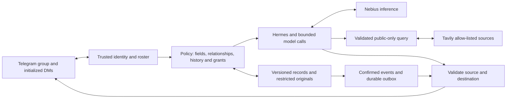

# Kin

**The family member who remembers everything — and tells no one who shouldn't know.**

Kin is a planned private, always-on care coordinator for families looking after an ageing parent. A caregiver sends a discharge photo in DM; Kin proposes source-supported records and a schedule for explicit confirmation, then sends each person an authorized reminder or summary. Later questions receive permitted facts and source excerpts. Restricted sharing needs a scoped Admin grant.

The design uses self-hosted records, Telegram transport and models served through Nebius. Permission checks cover retrieval, chat history, native agent tools and delivery. Approved context goes to remote inference; a self-hosted store does not mean all information stays local.

Built for the [Nebius x NVIDIA Global AI Hackathon](https://nebiusglobalaihackathon.devpost.com/), Personal AI track. Singapore locale; the locale is a swappable pack.

## Current status

Configuration/policy loading and setup checks exist; `kin serve`, persistent domain memory, intake and reminders are placeholders or planned. The YAML matrix does not yet enforce runtime permissions. Nano Omni is listed as dedicated-only; D0 must qualify an accessible image endpoint/model and its budget. See [ROADMAP.md](ROADMAP.md).

## Why

- 63 million US caregivers (1 in 4 adults), up ~50% since 2015; 55% perform medical/nursing tasks, 22% trained; 1 in 3 finds coordination hard (AARP/NAC 2025).
- Singapore is a super-aged society in 2026 (1 in 5 aged 65+); family eldercare hours projected to rise from 29 to 41 per week; 55% of working caregivers left work for a parent's doctor visit in the past six months.
- Coordination happens in a group chat and a shoebox of paper.
- Existing care services and coordination apps already offer useful collaboration and role permissions. Kin targets a combined chat workflow: source-grounded memory, confirmed scheduling, reusable skills and auditable field-level sharing.

Details: [docs/01-problem.md](docs/01-problem.md).

## Planned minimum

| Flow | Intended behavior |
|---|---|
| Private intake | Photo → source-supported draft → Admin confirms exact records/schedule and permitted summaries |
| Reminder | Confirmed instructions and timezone; durable retries; supersession cancels future old events |
| Recall | Answer from authorized fields + approved source excerpt/crop |
| Sharing | Versioned recipient/view grant in Admin DM; one-shot or revocable standing share; access/delivery audit |
| Reusable skill | One persistent Monday task/reminder, with recipient permissions rechecked at execution |
| Local lookup | Public-only Tavily query and allow-listed source; no private record text |

English/Mandarin summaries use the same authorized fields. Audio debrief, arbitrary skill teaching, digests, Viewer expiry, full dataset and OpenShell/data-map polish are optional. Product: [docs/02-product.md](docs/02-product.md). Boundaries: [docs/03-privacy-boundaries.md](docs/03-privacy-boundaries.md).

## How it works



- **Hermes Agent:** runtime/chat/skill facilities; unfiltered native memory/history/tools must be isolated before family data is used.
- **Kin policy/store:** authenticated identity, permitted field/source projections, confirmed schedules and per-destination authorization.
- **Nebius Token Factory:** NVIDIA Nemotron text reasoning plus a qualified image extractor. Dedicated Nano Omni is one option; an available Token Factory vision model plus Nemotron is another. Audio is separately optional.
- **OpenShell/NemoClaw:** optional process/network isolation after core privacy controls; it does not supply family-role authorization.
- **Tavily:** validated public topics with domain filtering.

Architecture: [docs/05-architecture.md](docs/05-architecture.md).

## Safety

Kin organises; it does not diagnose or dose. The target requires sources, exact-version schedule confirmation and conflict blocking; it does not infer drug interactions. Optional audio needs consent before processing. No real personal data is used in the demo. [docs/04-safety.md](docs/04-safety.md).

## Demo

All demo data is synthetic: fictional family, fictional institutions, generated documents. [docs/06-synthetic-data.md](docs/06-synthetic-data.md) · [docs/07-demo-plan.md](docs/07-demo-plan.md).

## Quick start

Requires [uv](https://docs.astral.sh/uv/) (Python 3.12 is fetched automatically) and Docker with Compose v2 for the runtime.

```bash
make setup             # dependencies; example .env; data/ and hermes/home/
$EDITOR .env           # private keys, verified Telegram IDs, qualified endpoints/models
make policy            # validate matrix shape; runtime authorization is still planned
make lint
make test
make models            # IDs actually visible to the account
make check             # live configured model/image, Telegram and Tavily probes
```

Current live checks need credentials and a qualified image endpoint; `check-nospend` still needs network/keys. `make up` starts the scaffold, not completed intake/reminders. `hermes/config.yaml` seeds the runtime and leaves Kin MCP disabled; enabling it requires D2 authenticated serving and context isolation. [KICKOFF.md](KICKOFF.md) explains the actual setup gates.

Layout:

```
kin/
  README.md · AGENTS.md · KICKOFF.md · ROADMAP.md · LICENSE (Apache-2.0)
  pyproject.toml · uv.lock · .python-version · .env.example
  Makefile · Dockerfile · docker-compose.yml
  kin/               # package: config, policy, cli, setup_check; intake/retrieve/serve land per ROADMAP
  config/policy.yaml # default role × category matrix
  locale/sg/         # Singapore locale pack (languages, lookup allow-list, terms, document types)
  hermes/            # config.yaml template; home/ is the gateway's persistent volume (git-ignored)
  docker/hermes/     # Hermes container (installs on first start, runs `hermes gateway run`)
  data/              # family data volume (git-ignored)
  tests/ · docs/ · .github/workflows/ci.yml
```

## How we use Nebius and NVIDIA

_Complete from successful product runs: exact model IDs and endpoint types, image/text usage, measured latency and estimated/actual cost, approved data sent externally, persistent memory/skill evidence and the deployed isolation. Setup probes alone do not establish a completed product._

## Docs

| Doc | Content |
|---|---|
| [AGENTS.md](AGENTS.md) | Instructions for coding agents: reading order, conventions, constraints, guardrails |
| [KICKOFF.md](KICKOFF.md) | One-time setup; items needing the human are marked |
| [ROADMAP.md](ROADMAP.md) | Sequential deliverables and order of work |
| [00-hackathon.md](docs/00-hackathon.md) | Hackathon requirements, judging criteria, dates, platform facts |
| [01-problem.md](docs/01-problem.md) | Problem, evidence, users, landscape ([sources](docs/sources.md)) |
| [02-product.md](docs/02-product.md) | Scope, roles, categories, flows, chat conventions |
| [03-privacy-boundaries.md](docs/03-privacy-boundaries.md) | Boundary model, policy matrix, enforcement, audit |
| [04-safety.md](docs/04-safety.md) | Organiser-not-adviser rules, grounding, consent, data protection |
| [05-architecture.md](docs/05-architecture.md) | Components, data model, flows, models, integrations |
| [06-synthetic-data.md](docs/06-synthetic-data.md) | Demo family, timeline, document set, generation |
| [07-demo-plan.md](docs/07-demo-plan.md) | Video script, judge access |
| [08-submission-checklist.md](docs/08-submission-checklist.md) | Devpost requirements, feedback template |

## License

Apache-2.0.
