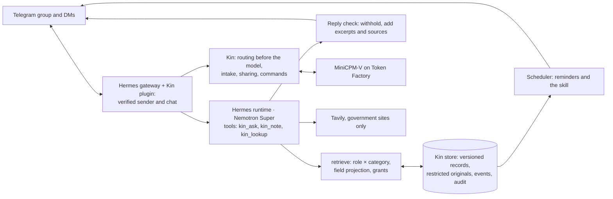

# Kin

**The family member who remembers everything — and tells no one who shouldn't know.**

Kin is a private, always-on care coordinator for families looking after an ageing parent. It lives in the family's Telegram group and in each member's DM. The primary caregiver photographs a discharge letter in DM; Kin drafts the records with source excerpts, the caregiver confirms, and the schedule goes live: reminders to the helper's phone, a confirmed summary to the group in English and Mandarin. Months later, when a brother overseas asks "what did Dr Tan change last time?", Kin answers from permitted records with the source excerpt. A question about the insurance claim gets a neutral group reply and a private request to the caregiver: share it, once, or not.

Records live on self-hosted storage; Telegram carries messages; approved context goes to **NVIDIA Nemotron on Nebius Token Factory** for inference. Each person sees only what their role allows, enforced in code before retrieval and again before every reply is sent — not by prompt.

Built for the [Nebius x NVIDIA Global AI Hackathon](https://nebiusglobalaihackathon.devpost.com/), Personal AI track. Singapore locale; the locale is a swappable pack. All data in this repository and in the demo is synthetic.

## Why

- 63 million US caregivers (1 in 4 adults), up ~50% since 2015; 55% perform medical/nursing tasks, 22% trained; 1 in 3 finds coordination hard (AARP/NAC 2025).
- Singapore is super-aged in 2026 (1 in 5 aged 65+); family eldercare hours projected to rise from 29 to 41 per week; 55% of working caregivers left work for a parent's doctor visit in the past six months.
- Coordination happens in a group chat and a shoebox of paper; existing apps are cloud SaaS or human services. Kin combines chat-native intake, source-grounded memory, confirmed scheduling, a reusable skill and audited per-person sharing.

Details: [docs/01-problem.md](docs/01-problem.md).

## What works

Validated live in Telegram on 18–19 Oct 2026 with two accounts playing Admin, Family and Carer, and covered by 75 automated tests ([ROADMAP.md](ROADMAP.md) records the evidence).

| Flow | Behaviour |
|---|---|
| Private intake | Admin sends a photo in DM → MiniCPM-V transcribes it → Kin checks the draft (a medicine name that matches no record, a time that clashes with another document, unreadable fields) and asks one question at a time → Admin confirms → records active |
| Schedule | Confirmed medicines become reminders at the household's times; a superseded medicine's reminders stop; a course ends on its date; the evening-before appointment reminder and a refill date are calculated, never invented |
| Reminders | Sent to the assignee's DM, once, even across restarts; the recipient's access is re-checked when each one fires |
| Group summary | Only after the Admin approves the exact text; only fields every member may see; English and Mandarin (names and numbers kept exactly) |
| Recall | Answers from the asker's permitted records; Kin attaches the approved excerpt itself and withholds any reply that contains something that chat may not see |
| Sharing | A finance or legal question gets a neutral reply; the Admin answers Yes / No / Just this once; the answer goes privately to the asker as the approved excerpt, never the original; `/revoke` ends it; everything is audited and `/who_saw` reports it in plain words |
| Reusable skill | "Every Monday 08:00, remind Siti to refill the pill organiser and tell Mei Ling when done": stored in Kin, survives restart, recipients re-authorised when it runs, Done reported back, `/skills` per role |
| Public lookup | Scheme rules (Home Caregiving Grant, CHAS…) via Tavily: the query is only the scheme's name, searched on the locale's government sites; Kin cites the page and never decides eligibility |

Not built (optional in the plan): audio (no public audio model on Token Factory), visit debrief from an after-visit summary, teach-by-chat skills, weekly digests, OpenShell/NemoClaw isolation, `/export`.

## Try it (judges)

The bot and the group invite link are in the Devpost submission's testing instructions. The demo family is made up; one Telegram account plays all of them, and messages for someone you aren't playing arrive labelled "For Mei Ling (Admin):".

| # | Where | Send | Expect |
|---|---|---|---|
| 1 | Bot DM | Start, then `/demo admin` | You are Mei Ling, who keeps the family's records |
| 2 | Bot DM | `/demo photos`, then send page 1 and page 2 back (forward, or save and send) | "Reading it now…", then a draft from the Discharge summary, 23 Oct 2026. If Kin asks "Did you mean Glipizide?", tap it. Tap **Confirm** (about 10 s a page) |
| 3 | Bot DM | Tap **Post to group** | The group gets the update in English and Mandarin: Metformin 500 mg, Glipizide stopped, Emergency Department advice; no diagnosis. A labelled copy of Siti's new schedule arrives too |
| 4 | Bot DM | `/demo family` | You are Wei Jie, her brother overseas |
| 5 | Group | `Kin, what did Dr Tan change at the last visit?` | Losartan 50 mg once a day in the morning, Clinic memo 26 Jun 2026, ending with the quoted plan line |
| 6 | Group | `Kin, has the insurance claim gone through?` | The group sees only "I've asked Mei Ling to share that." Your DM gets "For Mei Ling (Admin): Wei Jie asked…" with buttons |
| 7 | Bot DM | Tap **Just this once** | "Mei Ling shared this with you: “Your claim is under assessment…”", without the amount or claim number |
| 8 | Bot DM | `What did Dr Tan write about her blood pressure?` and `Please send me the discharge letter.` | No clinical notes reach Wei Jie; originals are never sent |
| 9 | Group | `Kin, is Ah Ma eligible for the Home Caregiving Grant?` | The published criteria with an aic.sg or moh.gov.sg link; Kin doesn't decide eligibility |
| 10 | Bot DM | `/demo monday` | Monday 08:00 in the demo family: Siti's morning medicines (the new Metformin dose) and the pill-organiser skill. Tap **Done**: Mei Ling is told |
| 11 | Bot DM | `/demo admin`, then `/who_saw` and tap Insurance letter | Who was shown what, by name and time; also try `/skills`, `/reminders` and `/revoke` |
| 12 | Bot DM | `/demo reset` | The family starts over (it also resets nightly) |

One tester at a time: the next person to use `/demo` signs the previous one out. In the demo, reminders run on `/demo monday` rather than the clock, so nobody is woken at 3 am.

## How it works



- **Hermes Agent** (MIT) is the runtime and the only Telegram poller. A small Kin plugin passes the sender's identity from the gateway session to Kin's tools (Hermes gives MCP servers none), routes photos, commands and button taps to Kin before any model runs, and sends every final reply past Kin's check. Hermes' own memory, session search, skills, cron, web and host tools are off.
- **The kin service** owns the store, the policy, intake, sharing, the scheduler and the reply check. It is reachable only from the Hermes container.
- **Policy** is data: `config/policy.yaml` (role × category matrix and field projections) and `config/members.yaml` (roster). In the group, Kin shows only what every member may see.

Architecture: [docs/05-architecture.md](docs/05-architecture.md). Boundaries: [docs/03-privacy-boundaries.md](docs/03-privacy-boundaries.md).

## How we use Nebius and NVIDIA

Every model call goes to **Nebius Token Factory** (`https://api.tokenfactory.nebius.com/v1/`, OpenAI-compatible); there is no other inference provider.

| Model | Used for |
|---|---|
| `nvidia/nemotron-3-super-120b-a12b` (Nemotron 3 Super) | Every conversation turn in Hermes: choosing Kin's tools and composing grounded answers; the Mandarin group post |
| `openbmb/MiniCPM-V-4_5` | Reading photos: document type, which section headings a page shows, and a verbatim transcription. Nemotron Nano Omni is dedicated-only on Token Factory, so this public vision model stands in |
| `nvidia/NVIDIA-Nemotron-3-Nano-30B-A3B` | Validated at D0 for bounded structured outputs; not on a live path, because policy decisions never depend on a model's classification |

Measured with `make measure` on 19 Oct 2026 (real calls; list prices):

| Task | Model | Calls | Seconds | Tokens in / out | Cost (USD) |
|---|---|---|---|---|---|
| Intake, discharge summary page 1 | MiniCPM-V 4.5 | 3 | 6.3 | 1,334 / 432 | 0.0014 |
| Intake, discharge summary page 2 | MiniCPM-V 4.5 | 3 | 4.7 | 1,306 / 322 | 0.0012 |
| Mandarin group post | Nemotron 3 Super | 1 | 1.6 | 252 / 219 | 0.0003 |
| Grounded answer (one call) | Nemotron 3 Super | 1 | 1.3 | 1,346 / 107 | 0.0005 |
| Tavily lookup | — | 1 | 3.3 | — | 1 credit |

In the live validation, 16 Telegram turns took 5.1 s median (9.2 s p90); 14 of them called a Kin tool, which takes two Super calls per turn. Hermes' system prompt is 6.3 KB plus 1.2 KB of tool schemas, so a question costs roughly USD 0.002. A family asking ten questions a day and sending two documents a week would spend well under USD 1 a month at list prices.

Thinking mode is switched off for Kin's own calls (`chat_template_kwargs.enable_thinking: false`): with it on, MiniCPM-V and Super spent their token budget reasoning and returned truncated output. Medicine and people's names are masked while Super translates, because it otherwise translated them, once into a different drug.

**What leaves the host:** messages and photos travel through Telegram; the records and excerpts a person may see in that chat, and photos sent for intake, go to Token Factory for inference; Tavily receives only a listed scheme's name. Records, originals and the audit log stay in SQLite and files on the host.

**Deployed isolation:** one Docker Compose project on a host shared with other services; no published ports (Telegram is outbound polling; the kin API is reachable only from the Hermes container and needs a shared token); capped memory, CPU and processes; Hermes' file, terminal, code, browser and web tools off. OpenShell/NemoClaw is not deployed.

## Safety

Kin organises confirmed records and reminders. It never diagnoses, doses, triages or infers drug interactions; discrepancies between documents are shown to the Admin, never resolved silently, and nothing is scheduled until the Admin confirms. Every personal answer names its source. Requests for an original document, and taps on old buttons, get fixed replies rather than a model's. [docs/04-safety.md](docs/04-safety.md).

Limitations: one family per deployment; the demo serves one tester at a time; reminders depend on Telegram delivery and the family keeping a DM open with the bot; audio is not processed; Kin's reply check withholds verbatim leaks but a paraphrase of something seen earlier in a session is only prevented by the model's instructions, so a role change starts a fresh session.

## Run it yourself

Requires [uv](https://docs.astral.sh/uv/) and Docker with Compose v2. Setup gates: [KICKOFF.md](KICKOFF.md).

```bash
make setup             # deps; .env from the example; data/ and hermes/home/
$EDITOR .env           # keys, the family group, verified Telegram IDs
make lint && make test
make check             # live probes: models, one image call, Telegram getMe, Tavily
make up                # kin service + Hermes gateway (first start installs Hermes into ./hermes/home)
make seed              # reset the store to the Week 0 synthetic fixture
make hermes-config     # after editing hermes/config.yaml or hermes/SOUL.md
make measure           # the table above (spends a few cents)
```

Judge demo: set `KIN_DEMO=true` and `TELEGRAM_ALLOW_ALL_USERS=true` in `.env`, run `make up`, then `make demo-reset`. Reset it nightly with cron, e.g. `0 4 * * * cd /path/to/kin && make demo-reset >> data/demo-reset.log 2>&1`. Use the demo only with the synthetic fixture.

## Layout

```
README.md · AGENTS.md · KICKOFF.md · ROADMAP.md · LICENSE (Apache-2.0)
pyproject.toml · uv.lock · .env.example · Makefile · Dockerfile · docker-compose.yml
kin/        # api, inbound (routing), retrieve and answer (policy), intake and extract,
            # flows, prompts, share, schedule, skills, lookup, translate, admin, demo, store
config/     # policy.yaml (matrix, projections), members.yaml (demo roster and household)
locale/sg/  # languages, timezone, lookup allow-list and schemes
fixtures/   # synthetic documents: ground truth, expected outcomes, renders, photos
hermes/     # config template, SOUL.md (persona), plugins/kin (the bridge); home/ is the runtime volume
tests/ · docs/ · .github/workflows/ci.yml
```

## Docs

| Doc | Content |
|---|---|
| [ROADMAP.md](ROADMAP.md) | Deliverables, gates and validation evidence |
| [00-hackathon.md](docs/00-hackathon.md) | Requirements, judging, prizes, platform facts |
| [01-problem.md](docs/01-problem.md) | Problem, evidence, landscape ([sources](docs/sources.md)) |
| [02-product.md](docs/02-product.md) | Roles, flows, chat conventions |
| [03-privacy-boundaries.md](docs/03-privacy-boundaries.md) | Boundary, matrix, tests |
| [04-safety.md](docs/04-safety.md) | Organise-not-advise, confirmation, data flow |
| [05-architecture.md](docs/05-architecture.md) | Components, Hermes ↔ Kin, models, flows, deployment |
| [06-synthetic-data.md](docs/06-synthetic-data.md) | Demo family and fixture |
| [07-demo-plan.md](docs/07-demo-plan.md) | Video script, judge access |
| [08-submission-checklist.md](docs/08-submission-checklist.md) | Devpost checklist |
| [09-devpost.md](docs/09-devpost.md) | Devpost description and feedback drafts |

## License

Apache-2.0.
