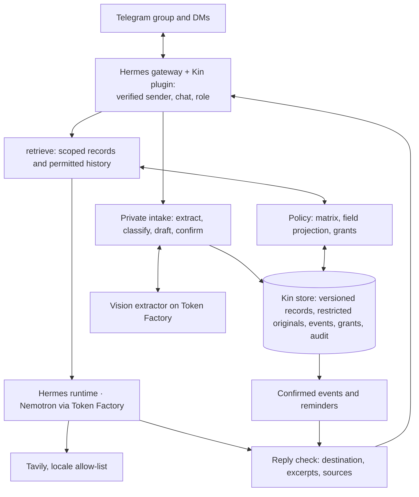

# 05 · Architecture

Implemented through D4: the Hermes gateway with the Kin plugin, the kin service (store, policy enforcement, intake, sharing, reminders, the reply check, lookup and the Monday skill). Optional and not built: OpenShell/NemoClaw isolation, teach-by-chat, visit debrief, the Serverless digest.

## Components

Hermes supplies the runtime and the Telegram gateway; Kin owns domain memory, policy, scheduling and the skill, reached through a Kin plugin inside Hermes (below). OpenShell/NemoClaw isolation and a Serverless digest service are optional.

## Hermes ↔ Kin

Hermes is the conversation runtime and the only Telegram poller. The kin service holds records, intake, policy and the scheduler. The two meet in one small Hermes plugin (`hermes/plugins/kin`, mounted read-only into the Hermes container, enabled with `plugins.enabled: [kin]`). It is a plugin rather than MCP because Hermes passes no caller identity to MCP servers: tool calls carry only the model's arguments.

**Identity.** For tools the plugin reads the sender's Telegram user ID, the chat ID and the chat type (`dm` or `group`) from the gateway's per-turn session context; for the hook it takes them from the message's source. It attaches them as `caller` to every request to the kin API, which also checks a shared `KIN_API_TOKEN`. Kin's tools take no identity arguments. Kin resolves the caller against the roster (`config/members.yaml`, IDs from `.env`); unknown senders get nothing, and a chat that is neither the family group (`TELEGRAM_HOME_CHANNEL`) nor the sender's own DM is refused. The hook skips both silently, so Hermes never runs for them. Everyone in the family group should be on the roster: the group's level is computed from the roster's roles.

**Message hook.** The plugin's `pre_gateway_dispatch` hook forwards every Telegram message (with the file for photos and documents) to `POST /inbound`; Kin decides, sends any reply itself and answers `pass` or `skip`. If kin is unreachable the hook skips (fails closed). Before the model runs:

| Inbound | Handling | Agent turn |
|---|---|---|
| Photo in the Admin's DM | Kin stores the original as restricted, extracts it in the background and replies with the draft (PDFs: not yet) | Skipped |
| Photo elsewhere (group, other DMs) | Not ingested; Kin replies that documents go to the Admin by DM | Skipped |
| An answer to the open question: the Admin's (a draft issue, Confirm / Discard, Post to group / Don't post, Yes / No / Just this once) or a skill's Done from its assignee | Kin applies it and asks the next question, activates, posts, grants or refuses, or tells the Admin the task is done | Skipped |
| A question about `finance`/`legal` from someone without access (`share_keywords`) | Share request to the Admin; the asker gets the same neutral reply whether or not a record exists | Skipped |
| Voice note or audio | Fixed reply: Kin can't listen yet, please type it | Skipped |
| A request for a document or photo itself ("send me the discharge letter") | Fixed reply: originals stay private; ask what you'd like to know from it | Skipped |
| A tap on an old button ("Post to group", "Just this once"…) with no question open | Fixed reply: already answered; the keyboard is removed | Skipped |
| Any `/command`: `/help`, `/start`, `/skills` (in DM, the skills this member may see), and for the Admin in DM `/roles`, `/who_saw`, `/reminders`, `/revoke`, `/export`; `/demo` in the judge fixture. `/who_saw` and `/revoke` offer documents or active shares as buttons (`kin/admin.py`); Kin sets each chat's command menu at start, which outranks the menus Hermes registers | Handled by Kin; other commands, including Hermes' own (`/model`, `/new`…), get "Try /help" | Skipped |
| Group text that doesn't say "Kin", @mention the bot or reply to one of Kin's messages | Ignored | Skipped |
| Any other text | — | Runs, with Kin's tools |

**Tools** (each call carries the caller from the session context):

| Tool | Does |
|---|---|
| `kin_ask(question)` | `retrieve(query, principal)`: permitted fields and approved excerpts for this caller in this chat, with fixed answering rules (sources, "I don't know", no advice); from D3 a blocked `finance`/`legal` question starts the share flow |
| `kin_note(text)` | Saves a note the caller owns (refused for roles without `write` on notes) |
| `kin_lookup(topic)` | Public scheme pages via Tavily. Kin matches a scheme named in the locale pack (`lookup_topics`) and builds the query from its name alone, so nothing else the model wrote leaves Kin; `include_domains` is the locale allow-list and results from other domains are dropped. Returned with the rule not to decide eligibility; other topics are refused |
| `kin_teach(instruction)` | Admin only, optional (D6): a structured skill with a confirmed trigger and recipients |

**Reply check.** The plugin's `transform_llm_output` hook posts every final Telegram reply, with the caller from the session, to `POST /outbound` before Hermes stores or sends it (`kin/answer.py`). Kin re-checks the destination: a reply that contains anything this chat may not see now (a hidden field, another member's record, an excerpt not approved for every reader) is replaced by "I can't share that here.", whatever the model picked up earlier in the session. The asker's own words don't count, so echoing a question can't reveal whether a hidden record holds them. Otherwise Kin appends the approved excerpts of the records this turn's `kin_ask` returned and the reply cites (by name, or by words shared with the excerpt), and the source of a `kin_lookup` the reply didn't link. If kin can't be reached, or a Telegram reply arrives without a caller, the hook sends "Kin is restarting" instead (fails closed). Gateway streaming and interim messages are off for Telegram, so no model text skips the check.

**Outbound.** Messages Kin starts — drafts, confirmed summaries, reminders, share requests, private answers' excerpts — are sent by the kin container through the Bot API (`sendMessage`). Only Hermes polls `getUpdates`; sending with the same token alongside it is allowed. Decisions use one-time reply keyboards, whose taps arrive as ordinary DM text for the hook to resolve, so no callback handling is needed. Each person has one open question at a time; a later one waits (they are told one is waiting) and is sent when the open one is answered (`kin/prompts.py`). When Telegram refuses a DM (the member never opened one), Kin asks the member in the group to tap Start.

**Retrieval.** `retrieve` loads only the categories the principal may see (filtered in SQL), drops rows an `own` qualifier excludes, keeps only the fields in `config/policy.yaml` `projections` (a `summary` level shows nothing without one) and attaches only excerpts whose approved audience includes the reader. In the group the reader is every roster role: categories are capped at the group's level, and fields (each role's projection at its own level) and excerpts must suit every role. Originals never leave the store. Every call, empty and refused ones included, is written to the audit log that `/who_saw` reads.

## Models

| Task | Model |
|---|---|
| Photo extraction: fields and source spans | MiniCPM-V 4.5 (`openbmb/MiniCPM-V-4_5`), the public image-capable model chosen at D0 (`KIN_MODEL_VISION`); Nano Omni is dedicated-only. Hermes uses the same model (`auxiliary.vision`) for any image it sees directly |
| Category classification, bounded structured tasks | Nemotron 3 Nano (`nvidia/NVIDIA-Nemotron-3-Nano-30B-A3B`) or Nemotron 3.5 Lightning |
| Grounded answers, summaries, skill interpretation | Nemotron 3 Super |
| Non-clinical hard cases (optional, capped) | Nemotron 3 Ultra |

Structured outputs are schema-checked; malformed or empty outputs are retried within a bound, then reported. On extraction failure the draft is kept and no event is created. Credits are per account and shared with Upgradient; a judge-period reserve is kept.

## Data

SQLite plus a private file store on the `data/` volume: members, versioned records (extracted → confirmed → active → superseded), restricted originals with approved excerpts, events (stable ID, record version, assignee, due time, status), grants, skills (a `tasks` record plus a weekly event), audit. Fields are listed in [03-privacy-boundaries.md](03-privacy-boundaries.md).

## Flows

**Intake:** hook verifies the sender is Admin in DM → original stored as restricted → the extractor classifies the document, detects which section headings the page shows, and transcribes only those sections (asked for a section on the other page, it copies a table it can see) → pages of one discharge summary sent within 20 minutes join one draft → code checks the draft: a medicine name that matches no known record ("Glibpizide" → Glipizide?), a date with two different times across documents, fields the model marked unreadable → one question at a time with reply-keyboard answers ("I'll type it" for a typed correction) → Confirm → records active, same-drug records superseded and their reminders cancelled, reminders created at the household times the draft showed, refills computed, appointment reminder the evening before → the carer gets the new schedule by DM → the Admin approves the group post (English, plus Mandarin when a roster member prefers `zh`) → posted. Medicine names are masked while Super translates and restored after; the Mandarin is dropped if any name or number is missing.

**Ask:** text addressed to Kin → Super calls `kin_ask` (caller from the session) → `retrieve(query, principal)` → permitted fields and excerpts → Super composes → reply check: withheld if it holds anything this chat may not see now, else the cited records' approved excerpts appended → delivered and audited.

**Sharing:** neutral group acknowledgment → Admin DM with requester, record, excerpt and a Yes / No / Just this once keyboard → hook → private answer to the requester's DM → audit.

**Skill:** the Admin-confirmed instruction is a `tasks` record with a weekly event → Kin's scheduler (locale timezone) claims it once per day → the recipient is re-authorised against the roster and policy (anyone who lost access gets nothing, and the Admin is told) → DM with a Done button → the assignee's Done goes to the Admin → last run on the event and in the audit; `/skills` lists it for those who may see it. Hermes cron stays off: its jobs run as agent turns without a caller identity.

**Lookup:** `kin_lookup` → a scheme from the locale pack, or refused → Tavily with that scheme's name only and `include_domains` from the locale pack → public pages to Super, the query audited → reply check adds the source link if the reply has none.

## Hermes hardening

`hermes/config.yaml` (seeded on first start, re-applied by `make hermes-config`) sets the Nebius provider and Super, routes images to the extractor, and turns off everything that would bypass Kin or reach the host: native memory and user profile, session search (unscoped across users and chats), skills, cron, terminal, code execution, browser, file, delegation and web search; voice transcription is off. `hermes/SOUL.md` is Kin's persona. Group sessions are keyed per chat and user. Installed version and tool inventory: Hermes v0.21.7; Telegram turns expose only Kin's tools (`kin_ask`, `kin_note`, `kin_lookup`). Secrets stay in the environment, never in prompts or logs.

## Deployment

Kin runs as the `kin` compose project (kin service + Hermes gateway) on a host shared with other deployments, including a separate Hermes stack:

- Own compose project, default network and images (`kin:dev`, `kin-hermes:dev`); no fixed container names.
- Own credentials: Kin's Telegram bot token (Telegram allows one poller per token), Nebius and Tavily keys.
- No published ports: Telegram is outbound polling, and kin is reachable only from the Hermes container (`http://kin:8765`).
- Capped resources and rotated logs (`mem_limit`, `cpus`, `pids_limit`, `local` log driver); `TZ` matches the locale's timezone.
- Hermes is installed into `./hermes/home` inside its container; nothing is installed on the host. Containers can still open connections to host ports bound to all interfaces; OpenShell/NemoClaw (D7) is the network-level control.

## External data flow

Telegram carries messages and media; the Kin store is self-hosted; approved context and images go to Nebius Token Factory; Tavily sees validated public topics. The README and video state these crossings and the isolation actually deployed.
