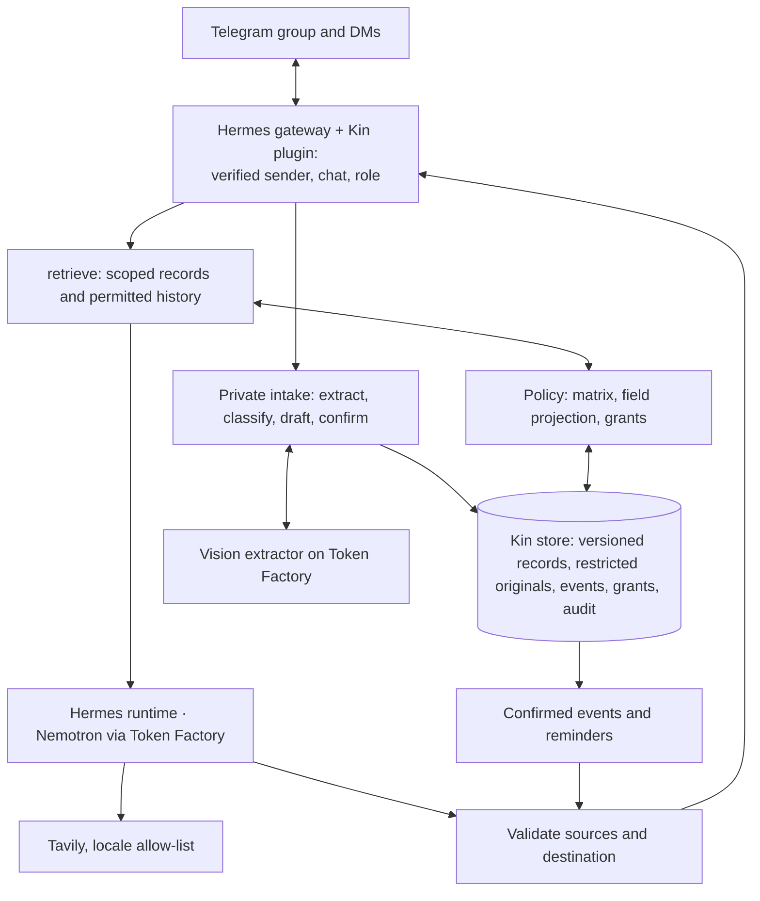

# 05 · Architecture

Target design. Configuration, policy and roster validation, setup checks, container templates and the containerised Hermes gateway exist; the kin service, the Kin plugin, enforcement and scheduling are not implemented.

## Components

Hermes supplies the runtime and the Telegram gateway; Kin owns domain memory, policy, scheduling and the skill, reached through a Kin plugin inside Hermes (below). OpenShell/NemoClaw isolation and a Serverless digest service are optional.

## Hermes ↔ Kin

Hermes is the conversation runtime and the only Telegram poller. The kin service holds records, intake, policy and the scheduler. The two meet in one small Hermes plugin (`hermes/plugins/kin`, mounted read-only into the Hermes container, enabled with `plugins.enabled: [kin]`). It is a plugin rather than MCP because Hermes passes no caller identity to MCP servers: tool calls carry only the model's arguments.

**Identity.** The plugin reads the sender's Telegram user ID, the chat ID and the chat type (`dm` or `group`) from the gateway's per-turn session context and attaches them as `caller` to every request to the kin API, which also checks a shared `KIN_API_TOKEN`. Kin's tools take no identity arguments. Kin resolves the caller against the roster (`config/members.yaml`, IDs from `.env`); unknown senders get nothing, and a chat that is neither the family group (`TELEGRAM_HOME_CHANNEL`) nor a roster member's DM is refused.

**Message hook.** The plugin's `pre_gateway_dispatch` hook handles these before the model runs:

| Inbound | Handling | Agent turn |
|---|---|---|
| Photo or PDF in the Admin's DM | File and caption to `POST /intake`; Kin stores the original as restricted and replies with the draft | Skipped |
| Photo elsewhere (group, other DMs) | Not ingested; Kin replies once that documents go to the Admin by DM | Skipped |
| Admin taps Confirm / Discard on a draft, or Yes / No / Just this once on a share request | `POST /decide`; Kin activates, discards, grants or refuses, and notifies | Skipped |
| Voice note or audio | Fixed reply: Kin can't listen yet, please type it | Skipped |
| `/help`, `/roles`, `/who_saw`, `/skills`, `/export`, `/demo` (fixture only) | `POST /command`; role-checked by Kin | Skipped |
| Group text that doesn't say "Kin", @mention the bot or reply to one of Kin's messages | Ignored | Skipped |
| Any other text | — | Runs, with Kin's tools |

**Tools** (each call carries the caller from the session context):

| Tool | Does |
|---|---|
| `kin_ask(question)` | `retrieve(query, principal)`: permitted fields and approved excerpts for this caller in this chat; a blocked `finance`/`legal` question starts the share flow and says so |
| `kin_correct(text)` | Admin only: corrections to the pending draft ("dose is 500 mg"); Kin re-validates and re-shows the draft |
| `kin_note(text)` | Saves a note or observation the caller owns |
| `kin_lookup(topic)` | Public scheme rules via Tavily with the locale allow-list; Kin builds the query and rejects names and record content |
| `kin_teach(instruction)` | Admin only, optional (D6): a structured skill with a confirmed trigger and recipients |

**Outbound.** Messages Kin starts — drafts, confirmed summaries, reminders, share requests, private answers' excerpts — are sent by the kin container through the Bot API (`sendMessage`). Only Hermes polls `getUpdates`; sending with the same token alongside it is allowed. Decisions use one-time reply keyboards, whose taps arrive as ordinary DM text for the hook to resolve, so no callback handling is needed. When Telegram refuses a DM (the member never opened one), Kin asks the member in the group to tap Start.

**Before D2.** Until the plugin exists, a photo reaches Hermes' own vision path (the extractor describes it, Super replies); from D2 every photo goes through Kin's intake.

## Models

| Task | Model |
|---|---|
| Photo extraction: fields and source spans | MiniCPM-V 4.5 (`openbmb/MiniCPM-V-4_5`), the public image-capable model chosen at D0 (`KIN_MODEL_VISION`); Nano Omni is dedicated-only. Hermes uses the same model (`auxiliary.vision`) for any image it sees directly |
| Category classification, bounded structured tasks | Nemotron 3 Nano (`nvidia/NVIDIA-Nemotron-3-Nano-30B-A3B`) or Nemotron 3.5 Lightning |
| Grounded answers, summaries, skill interpretation | Nemotron 3 Super |
| Non-clinical hard cases (optional, capped) | Nemotron 3 Ultra |

Structured outputs are schema-checked; malformed or empty outputs are retried within a bound, then reported. On extraction failure the draft is kept and no event is created. Credits are per account and shared with Upgradient; a judge-period reserve is kept.

## Data

SQLite plus a private file store on the `data/` volume: members, versioned records (extracted → confirmed → active → superseded), restricted originals with approved excerpts, events (stable ID, record version, assignee, due time, status), grants, skills, audit. Fields are listed in [03-privacy-boundaries.md](03-privacy-boundaries.md).

## Flows

**Intake:** hook verifies the sender is Admin in DM → store the original as restricted → extractor proposes fields and spans → classify → draft shown with uncertain fields and a Confirm / Discard keyboard; corrections via `kin_correct` → Admin confirms → records and events committed → confirmed summary to the group, reminder to the carer's DM.

**Ask:** text addressed to Kin → Super calls `kin_ask` (caller from the session) → `retrieve(query, principal)` → permitted fields and excerpt → Super composes → sources and destination validated → deliver and audit.

**Sharing:** neutral group acknowledgment → Admin DM with requester, record, excerpt and a Yes / No / Just this once keyboard → hook → private answer to the requester's DM → audit.

**Skill:** Kin's scheduler trigger (locale timezone) → Kin task with the Admin-confirmed instruction → recipients re-authorised → messages delivered → last-run recorded. Hermes cron stays off: its jobs run as agent turns without a caller identity.

**Lookup:** `kin_lookup` → public topic validated → Tavily with `include_domains` from the locale pack → cited public answer.

## Hermes hardening

`hermes/config.yaml` (seeded on first start, re-applied by `make hermes-config`) sets the Nebius provider and Super, routes images to the extractor, and turns off everything that would bypass Kin or reach the host: native memory and user profile, session search (unscoped across users and chats), skills, cron, terminal, code execution, browser, file, delegation and web search; voice transcription is off. `hermes/SOUL.md` is Kin's persona. Group sessions are keyed per chat and user. Installed version and tool inventory: Hermes v0.21.7; Telegram turns expose clarify, todo and vision, plus Kin's tools from D2. Secrets stay in the environment, never in prompts or logs.

## Deployment

Kin runs as the `kin` compose project (kin service + Hermes gateway) on a host shared with other deployments, including a separate Hermes stack:

- Own compose project, default network and images (`kin:dev`, `kin-hermes:dev`); no fixed container names.
- Own credentials: Kin's Telegram bot token (Telegram allows one poller per token), Nebius and Tavily keys.
- No published ports: Telegram is outbound polling, and kin is reachable only from the Hermes container (`http://kin:8765`).
- Capped resources and rotated logs (`mem_limit`, `cpus`, `pids_limit`, `local` log driver); `TZ` matches the locale's timezone.
- Hermes is installed into `./hermes/home` inside its container; nothing is installed on the host. Containers can still open connections to host ports bound to all interfaces; OpenShell/NemoClaw (D7) is the network-level control.

## External data flow

Telegram carries messages and media; the Kin store is self-hosted; approved context and images go to Nebius Token Factory; Tavily sees validated public topics. The README and video state these crossings and the isolation actually deployed.
