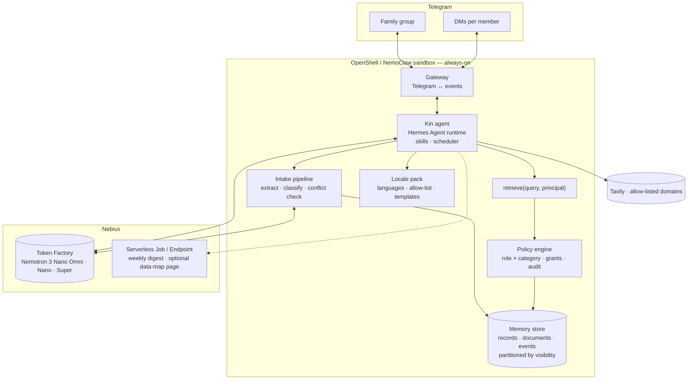

# 05 · Architecture

## Constraints

- Always-on; one family; Telegram.
- Single retrieval chokepoint; store partitioned by visibility; fails closed.
- Inference via Nebius Token Factory; a dedicated Nebius endpoint is supported for tenant isolation.
- Hackathon credits ≈ $50: Nano/Omni for volume; Super for answers; Ultra capped.

## Components

## Data model

- **Member**: `telegram_id`, `name`, `role`, `language`, `expires_at?`
- **Record**: `id`, `category`, `visibility`, `fields` (typed per category, e.g. medication {name, dose, frequency, start, end, prescriber}), `source_ref`, `created_by`, `created_at`, `supersedes?`
- **Document**: `id`, `type` (photo | pdf | audio), `storage_ref`, `extracted_text`, `pages/segments`, `created_at`
- **Event**: reminders, appointments, tasks — `assignee`, `due_at`, `status`, `record_ref`
- **Grant**: `record_or_category`, `grantee`, `scope`, `granted_by`, `at`
- **Audit**: `principal`, `query`, `records_shown`, `decision`, `at`
- **Skill**: `trigger` (cron | event), `principal`, `instruction`, `last_run`

Storage: SQLite + file store on the sandbox volume, partitioned by visibility class.

## Flows

**Intake.** Media message → Gateway → Intake: Nano Omni extracts fields/text → Nano classifies category → conflict check → clarifying question if confidence low → Record + Document stored (visibility from policy) → Events created → role-appropriate posts.

**Ask.** Message → intent → `retrieve(query, principal)` (policy applied before context) → Super composes answer with source references → Gateway attaches source crop/excerpt → Audit entry.

**Share request.** `retrieve` reports a policy block → admin DM with options → Grant stored → asker answered or declined → Audit.

**Debrief.** Audio + consent flag → Nano Omni transcription and summary → superseding medication Records → Events → per-role posts.

**Skills.** Hermes skill store; scheduler fires with the skill's principal; output passes through the policy path.

**Digest.** Weekly job (Hermes scheduler or Nebius Serverless Job) renders per-role digests per language.

## Models

| Task | Model |
|---|---|
| Photo/PDF/audio understanding; field extraction; translation | Nemotron 3 Nano Omni |
| Category classification; conflict detection; short answers | Nemotron 3 Nano 30B-A3B |
| Grounded answers; appointment prep; digests; skill interpretation | Nemotron 3 Super 120B-A12B |
| Hard record conflicts (capped) | Nemotron 3 Ultra 550B-A55B |

Served via Token Factory (OpenAI-compatible API).

Omni modality contingency: the Token Factory catalog lists `Nemotron-3-Nano-Omni` with modality "Text-to-text" on the public endpoint. `kin check` sends one image to it. If image/audio input is rejected on the public endpoint, the options in order are: a Token Factory **dedicated endpoint** for Nano Omni (tenant-isolated, matches the privacy story; cost per hour); another vision-capable model on Token Factory for extraction only, with Nemotron doing classification and answers (still satisfies "at least one NVIDIA open model" but weakens the Nemotron story); text-only intake from PDFs for the demo while the video shows the design. The outcome is recorded in ROADMAP D0.

## Integrations

- **Telegram Bot API** — group + DMs; group privacy mode disabled for the family group.
- **Hermes Agent** — runtime, memory interface, skills, gateway. Policy engine and `retrieve` are the only memory access path.
- **OpenShell / NemoClaw** — sandbox, credential proxying, network allow-list (Telegram API, Token Factory, Tavily, locale allow-list domains).
- **Tavily** — `search`/`extract` with `include_domains` from the locale pack; no record content in queries.
- **Locale pack** — folder: languages, lookup allow-list, document templates and label formats, local terms. Swapping the locale replaces the folder.
