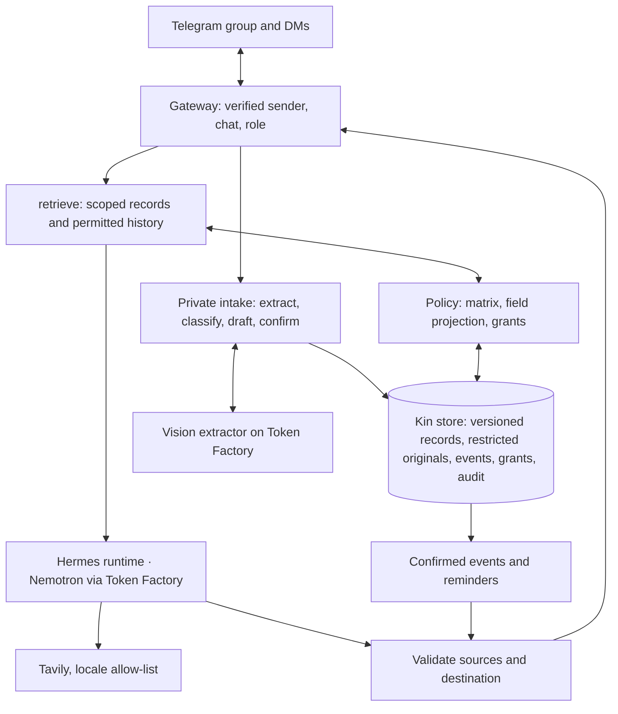

# 05 · Architecture

Target design. Configuration, policy validation, setup checks and container templates exist; the service, enforcement and scheduling are not implemented.

## Components

Hermes supplies runtime, Telegram gateway and scheduled skills; Kin owns domain memory and policy, exposed to Hermes as MCP tools (`mcp_kin_<tool>`) on the internal compose network. OpenShell/NemoClaw isolation and a Serverless digest service are optional.

## Models

| Task | Model |
|---|---|
| Photo extraction: fields and source spans | Public image-capable model on Token Factory, chosen at D0 (`KIN_MODEL_VISION`); Nano Omni is dedicated-only |
| Category classification, bounded structured tasks | Nemotron 3 Nano (`nvidia/NVIDIA-Nemotron-3-Nano-30B-A3B`) or Nemotron 3.5 Lightning |
| Grounded answers, summaries, skill interpretation | Nemotron 3 Super |
| Non-clinical hard cases (optional, capped) | Nemotron 3 Ultra |

Structured outputs are schema-checked; malformed or empty outputs are retried within a bound, then reported. On extraction failure the draft is kept and no event is created. Credits are per account and shared with Upgradient; a judge-period reserve is kept.

## Data

SQLite plus a private file store on the `data/` volume: members, versioned records (extracted → confirmed → active → superseded), restricted originals with approved excerpts, events (stable ID, record version, assignee, due time, status), grants, skills, audit. Fields are listed in [03-privacy-boundaries.md](03-privacy-boundaries.md).

## Flows

**Intake:** verify sender is Admin in DM → store the original as restricted → extractor proposes fields and spans → classify → draft shown with uncertain fields → Admin confirms → records and events committed → confirmed summary to the group, reminder to the carer's DM.

**Ask:** verify sender and chat → `retrieve(query, principal)` → permitted fields and excerpt → Super composes → sources and destination validated → deliver and audit.

**Sharing:** neutral group acknowledgment → Admin DM with requester, record, excerpt → Yes / No / Just this once → private answer → audit.

**Skill:** Hermes cron trigger → Kin task with the Admin-confirmed instruction → recipients re-authorised → messages delivered → last-run recorded.

**Lookup:** public topic validated → Tavily with `include_domains` from the locale pack → cited public answer.

## Hermes hardening

The seed `hermes/config.yaml` sets the Nebius provider and leaves Kin MCP disabled. D2 enables it after: identity binding at the gateway; Hermes native memory, session search and file/terminal tools disabled over family data; separate group and DM contexts; secrets outside prompts and logs; installed Hermes version and tool inventory recorded. `kin` exposes no public port in the demo deployment.

## External data flow

Telegram carries messages and media; the Kin store is self-hosted; approved context and images go to Nebius Token Factory; Tavily sees validated public topics. The README and video state these crossings and the isolation actually deployed.
