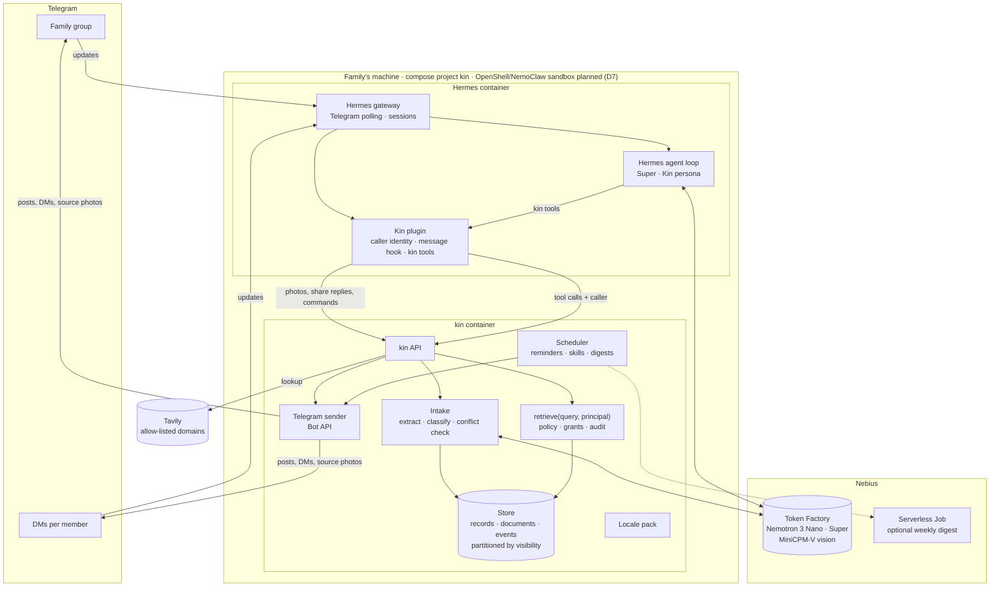

# 05 · Architecture

## Constraints

- Always-on; one family; Telegram.
- Single retrieval chokepoint; store partitioned by visibility; fails closed.
- Caller identity comes from the Telegram gateway, never from the model.
- Inference via Nebius Token Factory; a dedicated Nebius endpoint is supported for tenant isolation.
- Hackathon credits ≈ $50: Nano and the vision model for volume; Super for answers; Ultra capped.

## Components

## Hermes ↔ Kin

Hermes is the conversation runtime and the only Telegram poller. Kin's records, intake and boundaries live in the kin service. The two meet in one small Hermes plugin (`hermes/plugins/kin`, mounted read-only into the Hermes container and enabled with `plugins.enabled: [kin]`). It is a plugin rather than an MCP server because Hermes passes no caller identity to MCP servers, and every Kin decision depends on who is asking.

**Identity.** The plugin reads the sender's Telegram user ID, the chat ID and the chat type (`dm` or `group`) from the gateway's per-turn session context and sends them as `caller` with every request to the kin API, which checks a shared `KIN_API_TOKEN`. Kin's tools take no identity arguments, so a message claiming to be someone else changes nothing. Kin resolves the user against the roster (`config/members.yaml`, IDs from `.env`); anyone else in the family group gets `default_role`. A chat that is neither the family group (`TELEGRAM_HOME_CHANNEL`) nor a roster member's DM is refused.

**Message hook.** The plugin's `pre_gateway_dispatch` hook routes these messages deterministically, before the model runs:

| Inbound | Handling | Agent turn |
|---|---|---|
| Photo or PDF, in the group or a member's DM | File and caption uploaded to `POST /intake`; Kin acknowledges, processes in the background and posts the results itself | Skipped |
| Voice note or audio | Fixed reply: Kin can't listen yet, please type it | Skipped |
| Admin DM "Yes" / "No" / "Just this once" while a share request is pending | `POST /share/decide`; Kin answers the asker | Skipped |
| `/help`, `/roles`, `/who_saw`, `/skills`, `/export` | `POST /command`; admin-only except `/help` | Skipped |
| Group text that doesn't say "Kin", @mention the bot or reply to one of Kin's messages | Ignored (family members talk among themselves) | Skipped |
| Any other text: DMs, and group messages addressed to Kin | — | Runs, with Kin's tools |

**Tools.** Registered by the plugin; each call carries the caller from the session context.

| Tool | Does | kin API |
|---|---|---|
| `kin_ask(question)` | Records the caller may see in this chat, with sources. A blocked `finance`/`legal` question raises a share request and the tool says so | `POST /ask` → `retrieve(query, principal)` |
| `kin_note(text)` | Saves a note the caller owns | `POST /notes` |
| `kin_lookup(topic)` | Public scheme rules via Tavily with the locale allow-list; Kin builds the query and rejects names and record content | `POST /lookup` |
| `kin_teach(instruction)` | Admin only: stores a skill (trigger + instruction), D6 | `POST /skills` |

**Outbound.** Messages Kin starts — intake posts, reminders, share-request DMs, source photos, digests — are sent by the kin container through the Bot API (`sendMessage`, `sendPhoto`). Only Hermes polls `getUpdates`; sending with the same token alongside it is allowed. A share request carries a one-time reply keyboard ([Yes] [No] [Just this once]); a tap arrives as an ordinary DM text, which the hook resolves. A bot can DM only people who have opened a chat with it, so when a DM is refused Kin asks the member in the group to tap Start once.

**Off in Hermes.** Built-in memory, user profile, session search (which is not scoped by user or chat), skills and cron, plus the host-reaching toolsets and web search (`hermes/config.yaml`). The family's memory is Kin's store; skills are Kin's. Kin's persona and rules are `hermes/SOUL.md`. `make hermes-config` re-applies both files to the running install.

**Before D2.** Until the plugin exists, a photo reaches Hermes' own vision path (MiniCPM-V describes it, Super replies). From D2 every photo goes to Kin's intake, which keeps the original as the record's source.

## Data model

- **Member**: `id`, `telegram_id`, `name`, `role`, `language`, `expires_at?` — seeded from `config/members.yaml`
- **Record**: `id`, `category`, `visibility`, `fields` (typed per category, e.g. medication {name, dose, frequency, start, end, prescriber}), `source_ref`, `created_by`, `created_at`, `supersedes?`
- **Document**: `id`, `type` (photo | pdf), `storage_ref`, `extracted_text`, `pages`, `created_at`
- **Event**: reminders, appointments, tasks — `assignee`, `due_at`, `status`, `record_ref`
- **Grant**: `record_or_category`, `grantee`, `scope` (once | standing), `granted_by`, `at`
- **Audit**: `principal`, `query`, `records_shown`, `decision`, `at`
- **Skill**: `trigger` (cron | event), `principal`, `instruction`, `last_run`
- **Share request**: `asker`, `category`, `question`, `status`, `at`

Storage: SQLite + file store under `./data`, partitioned by visibility class.

## Flows

**Intake.** Photo/PDF → hook → `POST /intake` (file, caption, caller) → acknowledgement → the vision model extracts fields and text → Nano classifies the category and document type → conflict check against existing records → one clarifying question to the sender if needed; admin confirms a low-confidence category in DM → Record + Document stored → Events (medication times, refills, appointments) → posts: the group gets what its computed level allows (`docs/03-privacy-boundaries.md`), in English plus Mandarin when a roster member prefers `zh`; restricted items go to the DMs of members who may see them.

**Ask.** Text addressed to Kin → Hermes agent (Super) → `kin_ask` → `retrieve(query, principal)`: the principal is the caller's member record, capped at the group's level when the question is asked in the group → permitted records with sources → Kin sends the top source (photo crop or page) to the chat as a reply to the question → Super answers from the records and cites the same source → Audit entry.

**Share request.** `retrieve` blocks a `finance`/`legal` question → the asker hears "I've asked Mei Ling to share that" → admin DM with the reply keyboard → hook → `POST /share/decide` → Grant (`once` or `standing`) or refusal → Kin answers the asker by DM (never in the group) → Audit.

**Reminders.** Kin's scheduler (locale timezone) → DM to the assignee with the reason and source ("from discharge letter, 3 Oct").

**Debrief.** Photo of the clinic's after-visit summary → intake (`after_visit_summary`) → medication changes become superseding Records → tasks with owners → next appointment → per-role posts.

**Skills.** Admin teaches in DM ("every Monday remind Siti to refill the pill organiser") → `kin_teach` → Nano parses the trigger → stored with the admin as principal → Kin's scheduler runs it through `retrieve` → output via the Telegram sender. `/skills` lists them.

**Digest.** Weekly job in Kin's scheduler (or a Nebius Serverless Job) renders per-role digests per language.

## Models

| Task | Model |
|---|---|
| Photo/PDF understanding; field extraction | MiniCPM-V 4.5 (`openbmb/MiniCPM-V-4_5`), vision fallback for Nemotron 3 Nano Omni |
| Category classification; conflict detection; trigger parsing; translation | Nemotron 3 Nano 30B-A3B |
| Conversation; grounded answers; appointment prep; digests | Nemotron 3 Super 120B-A12B |
| Hard record conflicts (capped) | Nemotron 3 Ultra 550B-A55B |

Served via Token Factory (OpenAI-compatible API). Audio is not processed (`docs/04-safety.md`).

**Vision fallback.** Nemotron 3 Nano Omni is not in the public Token Factory catalog (`/v1/models`) for our key. Of the contingency options (a dedicated Nano Omni endpoint; another Token Factory vision model for extraction only; text-only PDF intake), Kin uses the second: `openbmb/MiniCPM-V-4_5` reads photos and documents, and Nemotron classifies, answers and drafts. The kin service reads it from `KIN_MODEL_VISION`; Hermes uses the same model through `auxiliary.vision` with `agent.image_input_mode: text` for any image that reaches it directly (Super is text-only). `kin check` sends one image to it (`vision:image`). The hard requirement of an NVIDIA open model in the product path is met by Nano and Super. When `make models` lists Nano Omni, set `KIN_MODEL_VISION` and `auxiliary.vision.model` to its ID; audio input would come with it.

## Integrations

- **Telegram Bot API** — group + DMs; group privacy mode disabled for the family group. Hermes polls; the kin container sends.
- **Hermes Agent** — gateway, sessions, conversation loop, persona. Kin's plugin supplies identity, routing and tools; Kin's `retrieve` is the only path to the family's records.
- **OpenShell / NemoClaw** — planned (D7): sandbox, credential proxying, network allow-list (Telegram API, Token Factory, Tavily, locale allow-list domains).
- **Tavily** — called by the kin service (`kin_lookup`): `search` with `include_domains` from the locale pack; no names or record content in queries.
- **Nebius Serverless** — optional weekly digest job.
- **Locale pack** — folder: languages, timezone, lookup allow-list, document types and fields, local terms. Swapping the locale replaces the folder.

## Deployment

Kin runs as the `kin` compose project (kin service + Hermes gateway) on a host shared with other deployments, including a separate Hermes stack. It stays self-contained:

- Own compose project, default network and images (`kin:dev`, `kin-hermes:dev`); no fixed container names.
- Own credentials: Kin's Telegram bot token (Telegram allows one poller per token), Nebius and Tavily keys.
- No ports on public interfaces: the Hermes gateway publishes none (Telegram is outbound polling); the kin API port is bound to `127.0.0.1` for debugging (`KIN_API_PORT`), and the plugin reaches kin over the compose network (`http://kin:8765`).
- Capped resources and rotated logs (`mem_limit`, `cpus`, `pids_limit`, `local` log driver).
- Hermes toolsets that could reach other host services or read the volume (terminal, code execution, browser, file, delegation) and Hermes' own web search are disabled in `hermes/config.yaml`. Containers on the compose network can still open connections to host ports bound to all interfaces; the OpenShell/NemoClaw network allow-list (D7) is the network-level control.
- Hermes is installed into `./hermes/home` inside its container; nothing is installed on the host. `TZ` (`.env`) matches the locale's timezone in both containers.
