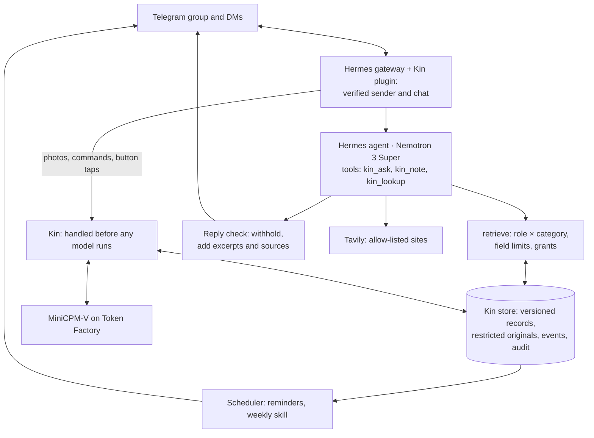

# 05 · Architecture

Two containers in one Docker Compose project. The **Hermes gateway** (Hermes Agent v0.21.7) polls Telegram and runs the model. The **kin service** owns the records, the policy, intake, sharing, the scheduler and the reply check. They meet in a small Hermes plugin.

## The Kin plugin

`hermes/plugins/kin` is a plugin rather than an MCP server because Hermes passes no caller identity to MCP tools, and every Kin decision depends on who is asking.

- **Identity.** The plugin reads the sender, chat and chat type from the gateway's session and attaches them to every call to the kin API, together with a shared `KIN_API_TOKEN`. Kin's tools take no identity arguments. Unknown senders, and chats other than the family group or the sender's own private chat, get nothing.
- **Before the model** (`pre_gateway_dispatch` → `POST /inbound`, `kin/inbound.py`). Kin handles these itself, and the model never runs:
  - photos (filed only from the admin's private chat)
  - answers to Kin's open question (Confirm, Post to group, Just this once…)
  - finance and legal questions (they become share requests)
  - `/commands`
  - requests for an original document
  - taps on old buttons
  - voice notes
  - group messages not addressed to Kin

  Everything else becomes an agent turn. If Kin is unreachable, the message is dropped (fails closed).
- **Tools.** `kin_ask(question)` returns the records and approved excerpts this caller may see in this chat, with answering rules. `kin_note(text)` saves the caller's own note. `kin_lookup(topic)` searches a public scheme.
- **Reply check** (`transform_llm_output` → `POST /outbound`, `kin/answer.py`). Every final reply goes back to Kin before it is sent:
  - **Withheld:** a reply holding anything this chat may not see now ("I can't share that here.").
  - **Otherwise:** Kin appends the approved excerpts of the records the reply cites, plus the lookup's source link.
  - **Kin unreachable:** the reply becomes "Kin is restarting".

  Streaming is off, so no model text skips the check.

## Kin service

- **Retrieval** (`kin/retrieve.py`) loads only the categories the role may see, keeps only the fields `config/policy.yaml` allows, and attaches only excerpts approved for the reader. In the group, the reader is every roster role at once. Originals never leave the store. Every call is audited.
- **Outbound.** Kin sends its own messages (drafts, reminders, share requests, group posts) through the Bot API. Decisions use one-time reply keyboards. Each person has one open question at a time, and later ones wait their turn (`kin/prompts.py`).
- **Store.** SQLite and files on the `data/` volume:
  - members
  - versioned records (draft → active → superseded)
  - restricted originals with approved excerpts
  - events with stable IDs
  - grants
  - the audit log

## Flows

- **Intake.** The admin sends a photo in a private chat, and the original is stored as restricted.
  - **Reading:** MiniCPM-V classifies the page, detects its section headings and transcribes them. Pages of one document sent within 20 minutes join one draft.
  - **Checks in code:** an unknown medicine name, a time that clashes with a filed appointment, unreadable fields. Kin asks one question at a time.
  - **On Confirm:** records go active, superseded medicines' reminders stop, new reminders are set at the household's times, and a dated follow-up becomes an appointment.
  - **Afterwards:** the helper gets the new schedule, and the admin approves the group post.
- **Ask.** Super calls `kin_ask`, composes the answer, and the reply check withholds it or adds excerpts.
- **Sharing.** A neutral reply goes to the group. The admin gets a private request (Yes / No / Just this once), and the answer goes privately to the asker as approved excerpts.
- **Skill.** A confirmed weekly event. When it fires, Kin re-checks the recipient against the policy, sends a Done button and reports Done to the admin. Hermes cron is off, because its jobs run without a caller identity.
- **Lookup.** The query is the name of a scheme listed in `locale/sg/locale.yaml`, searched only on its allow-listed domains.
- **Mandarin.** Super translates the approved English post. Medicine and people's names are masked during translation, and the Mandarin is dropped if any name or number is lost.

## Models

| Task | Model |
|---|---|
| Conversation turns, answers, Mandarin posts | Nemotron 3 Super (`nvidia/nemotron-3-super-120b-a12b`) |
| Photo reading | MiniCPM-V 4.5 (`openbmb/MiniCPM-V-4_5`); Nano Omni is dedicated-only on Token Factory |

Nemotron 3 Nano passed structured-output checks but is not on a live path: no policy decision depends on a model's classification. Thinking mode is off for Kin's calls.

## Hermes hardening

`hermes/config.yaml` (applied with `make hermes-config`) sets the Nebius provider and Super. It turns off everything that could bypass Kin or reach the host:
- native memory and user profiles
- session search
- skills and cron
- terminal, code, browser, file and web tools
- voice transcription

`hermes/SOUL.md` is Kin's persona; boundaries never depend on it.

## Deployment

- **Own compose project:** its own images, network, bot token and keys, on a host shared with other services.
- **No published ports:** Telegram is outbound polling, and the kin API is reachable only from the Hermes container.
- **Caps:** limited memory, CPU and process count, with rotated logs.
- **Not a network sandbox:** containers can still reach host ports bound to all interfaces. OpenShell/NemoClaw would close that, but isn't deployed.

## Code map

| Path | What it holds |
|---|---|
| `kin/api.py` | The HTTP API the plugin calls |
| `kin/inbound.py`, `flows.py`, `prompts.py` | Routing before the model; intake, sharing and group-post flows; the one-question queue |
| `kin/retrieve.py`, `answer.py`, `policy.py` | Policy enforcement, the reply check, policy loading |
| `kin/intake.py`, `extract.py`, `translate.py` | Drafts and checks, photo reading, Mandarin posts |
| `kin/schedule.py`, `skills.py`, `share.py`, `lookup.py` | Reminders, the weekly skill, grants, Tavily |
| `kin/admin.py`, `demo.py`, `store.py` | Admin commands, the judge demo, SQLite |
| `hermes/` | Config template, persona, the Kin plugin |
| `config/`, `locale/sg/`, `fixtures/`, `tests/` | Policy and roster, locale pack, synthetic documents, tests |
