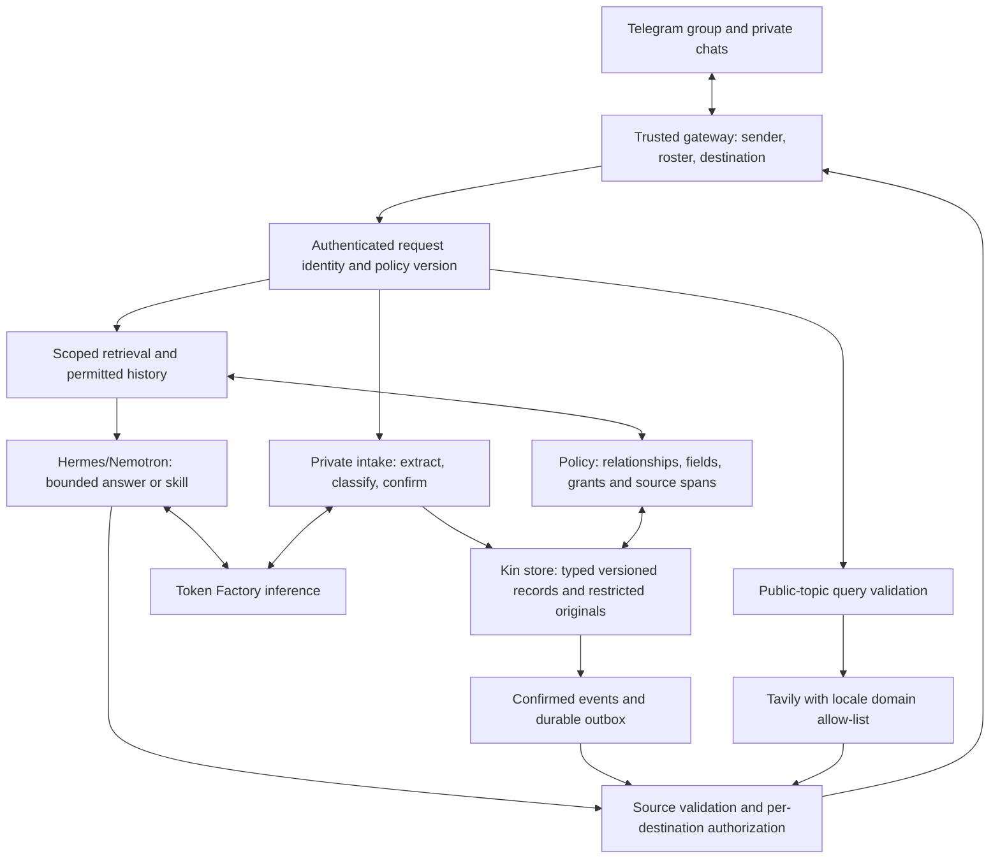

# 05 · Architecture

Target design. Current configuration, policy validation, setup checks and container templates are preparation; the service, authenticated retrieval and confirmed scheduling are not implemented.

## Components

Hermes supplies runtime/chat/skill facilities, but Kin owns domain memory and policy. OpenShell/NemoClaw can isolate the runtime after qualification; it does not implement family-role authorization. A separate Nebius Serverless digest/data-map service is optional.

## Model/deployment gate

[Nebius's current model page](https://nebius.com/services/token-factory/models/nvidia-nemotron-models-inference) lists Nano Omni as dedicated-only. Do not assume `KIN_MODEL_OMNI` on the shared endpoint supports photos or audio. D0 chooses and records an actual extraction path:

1. Confirm dedicated Nano Omni availability, image request shape, endpoint URL, pricing and available budget; approve only the compute actually needed for the demo period.
2. If unavailable or unaffordable, qualify an available vision model on Token Factory for extraction, with Nemotron Nano/Super doing classification and grounded text answers. Disclose the extraction model explicitly; this retains the required NVIDIA runtime use.
3. If only text intake is possible, update the scope, D0 gate, README and video to the actual capability before claiming a submittable product. A design animation is not evidence of working photo intake.

Audio is independently optional; an accepted image call does not qualify transcription. The current `make check` tests configured model IDs and one image only. Implementing the chosen provider/configuration is part of D0; documentation does not fix its current defaults or make the probe pass.

## Minimum data and events

SQLite holds family members, versioned typed records, grants, confirmed events, skills, requests and outbox/audit entries. Restricted files and approved crops live in a private file store. Relationships and projections are specified in [03-privacy-boundaries.md](03-privacy-boundaries.md).

- Record states: extracted, confirmed, active, superseded; source spans and exact confirmation version are retained.
- Event: stable ID, record/version, assignee, due time/timezone, status and authorized destination.
- Skill: structured trigger, execution identity, task/recipients, confirmed instruction, version and last-run key. One reusable scheduled skill is minimum; arbitrary code generation is outside that path.
- Outbox: request/event ID, payload/projection hash, recipient, current policy version, delivery state and transport receipt. Retries reuse IDs; uncertain delivery cannot be represented as a fresh successful send.

Transactions enforce confirmation/supersession, event deduplication and one-shot grant reservation. Reauthorize queued work at send time; policy changes invalidate cached projections and queued restricted output.

## End-to-end flows

**Intake:** authenticate private sender → quarantine media → extract fields/source spans → classify/split → show source-supported draft → Admin confirms schedule and sharing → commit confirmed records/events → per-destination permitted summary. Mixed originals remain Admin-only.

**Ask:** authenticate identity/destination → construct permitted history → retrieve authorized field/source projection → Super answers → validate citations/fields → recheck destination → deliver and audit. The model never chooses another identity or reads raw files directly.

**Sharing:** neutral acknowledgment → scoped request/approved view in Admin DM → authenticated callback binds record/version, grantee and destination → reserve grant → bounded answer → delivery reconciliation/audit. No implicit category-wide grant.

**Scheduled skill:** durable trigger/last-run ID → authorized record reads → new task/event → independently projected recipient messages. The Admin execution identity does not elevate Carer recipients.

**Lookup:** validate public topic/institution before Tavily → domain-filtered results → cited public response. No family record text enters outbound queries.

## Hermes and service hardening gate

The seed config currently uses shared Hermes home/state and leaves Kin MCP disabled; `kin serve` exits as a placeholder and Compose runs a self-check. D2 must implement serving and authenticated request binding before enabling MCP. Keep the server internal or protect local access; current exposed Compose ports are not evidence of transport authorization.

Native Hermes memory is injected into context and session search can access stored messages. Disable or isolate all unfiltered memory/history/file paths over family data. Construct group and member DM contexts separately, and invalidate them appropriately after policy changes. Do not rely on terminal backend selection or a prompt to disable tool access. Verify the actual installed/pinned Hermes tool set and background memory/skill behavior. [Memory documentation](https://hermes-agent.nousresearch.com/docs/user-guide/features/memory)

Restrict the process to required volumes, scopes and outbound destinations; never mount raw family storage into model-accessible tools. Secrets stay outside generated prompts/logs. Qualify OpenShell network/credential integration at D7 if added; record the actual deployed boundary. The minimum privacy tests apply whether OpenShell is present or deferred.

## Models, failure behavior and budgets

- Selected vision extractor: draft fields only; category/meaning decisions and confirmations remain explicit.
- Nemotron Nano: classification and bounded text tasks; Super: grounded wording and skill interpretation. Discover exact IDs with `make models`; do not copy stale Nano IDs between repos.
- Ultra is optional for non-clinical reasoning and cannot decide medical conflicts or permissions.
- Declare request output/action/token/spend limits and timeouts; accept structured schemas, reject malformed calls and use bounded retries. D0 qualifies the model/tool loop, not only a smoke reply.
- Cache public lookups; cache private results by family, principal, field projection, record and policy versions. Translation caches carry the same restrictions.
- On model/extraction failure preserve drafts and existing confirmed schedules, report the incomplete result, and do not create new reminders.
- Reserve actual account credits for judge access. Confirm dedicated pricing and total operating cost separately from per-token estimates.

## External data flow

Telegram carries source messages/media; the Kin store is self-hosted; approved context/extraction inputs go to Nebius; Tavily sees validated public-only topics. A dedicated endpoint remains remote inference. The README/video must identify those crossings and the actually deployed isolation, rather than claim all information stays local.
